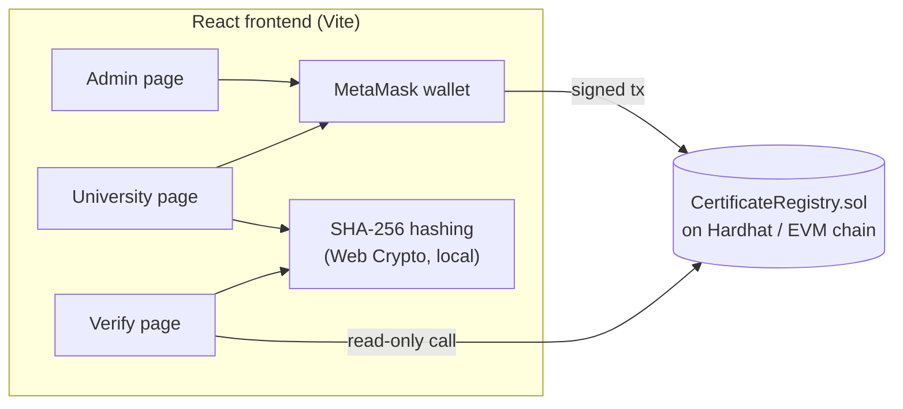

# DegreeChain: Blockchain-Based Degree Verification

A tamper-proof system for issuing and verifying university degrees, built for the
**Blockchain & Technology Applications** Complex Engineering Problem (CEP).

The blockchain is used **only as a digital record store**. There is no token, no
cryptocurrency and no payment logic.

---

## 1. Problem

- Fake degrees are a recurring problem in hiring, professional licensing and public office.
- Verifying a real degree is slow: employers send documents to the regulator or the
  university and wait days or weeks.
- Paper and PDF certificates are easy to edit or forge.

## 2. Solution

Universities record each degree on a blockchain. Anyone can then verify it in
seconds, for free, without contacting the university.

| Role | Who | Can do |
|---|---|---|
| **Owner / Regulator** | e.g. HEC | Approve, suspend or re-activate universities |
| **University** | Approved institution wallet | Issue certificates, revoke its own certificates |
| **Verifier** | Employer, embassy, anyone | Verify by certificate ID, QR code or by uploading the file |

### Why blockchain?

- **Immutable**: once recorded, a degree cannot be edited, not even by the admin. It can only be revoked, and the revocation is itself recorded.
- **Tamper-evident**: the SHA-256 fingerprint of the degree file is stored on-chain. Changing even one character in the PDF changes the hash, so a forged file fails verification.
- **No middleman**: verification is a free, public read from the chain.
- **Privacy**: the degree file never leaves the user's computer. It is hashed in the browser and only the 32-byte hash is stored.

## 3. Architecture



### Issue flow

1. University connects its approved wallet and fills in the student details.
2. The degree PDF is hashed (SHA-256) in the browser.
3. `issueCertificate(...)` stores the details and hash on-chain and returns a unique **certificate ID**.
4. The app shows a **QR code** linking to `/verify/<certificateId>`.

### Verify flow

- **By ID / QR**: `verifyCertificate(id)` returns the record and whether it is valid or revoked.
- **By file**: the uploaded file is hashed and `findByDocumentHash(hash)` looks it up. No match means the file is fake or was edited.
- On the ID result page, a verifier can also drop the candidate's PDF to confirm it is the exact registered file.

## 4. Tech stack

| Layer | Technology |
|---|---|
| Smart contract | Solidity 0.8.24 |
| Development chain & tests | Hardhat, Ethers v6, Chai |
| Frontend | React 18, Vite 5, React Router |
| Wallet | MetaMask |
| Hashing | SHA-256 (Web Crypto API) |
| QR codes | qrcode.react |

## 5. Project structure

```
├── contracts/
│   └── CertificateRegistry.sol    # the smart contract
├── scripts/
│   ├── deploy.js                  # deploys + writes address to the frontend
│   └── seed.js                    # issues 3 sample certificates for demos
├── test/
│   └── CertificateRegistry.test.js
├── frontend/
│   ├── src/
│   │   ├── contract/              # ABI + deployment.json (address)
│   │   ├── lib/                   # blockchain helpers, hashing
│   │   ├── context/               # wallet state
│   │   ├── components/            # Navbar, CertificateCard, FileDrop…
│   │   └── pages/                 # Home, Verify, University, Admin
│   └── vercel.json                # SPA routing for later deployment
└── hardhat.config.js
```

## 6. Smart contract API

| Function | Access | Purpose |
|---|---|---|
| `addUniversity(address, name)` | Owner | Approve a university |
| `setUniversityStatus(address, bool)` | Owner | Suspend / re-activate (old certificates stay valid) |
| `transferOwnership(address)` | Owner | Hand the registry to a new regulator wallet |
| `issueCertificate(name, roll, degree, cgpa, year, docHash)` | Active university | Record a degree, returns `certId` |
| `revokeCertificate(certId, reason)` | Issuing university | Revoke with a reason |
| `verifyCertificate(certId)` | Anyone | `(exists, valid, record, universityName)` |
| `findByDocumentHash(hash)` | Anyone | `certId` or `0x0` |
| `getUniversities()` / `getUniversity(addr)` | Anyone | University list / details |
| `getCertificatesByUniversity(addr)` | Anyone | IDs issued by a university |

Safety rules enforced on-chain: one document can only be registered once,
empty fields are rejected, only the issuer can revoke, and a certificate cannot be revoked twice.

## 7. Running locally

**Requirements:** Node.js 18+ and the MetaMask browser extension.

```bash
# 1. Install dependencies
npm install
npm run frontend:install

# 2. Run the tests
npm test

# 3. Start a local blockchain (keep this terminal open)
npm run node
```

In a **second terminal**:

```bash
# 4. Deploy the contract (also registers "Demo University")
npm run deploy:local

# 5. (optional) Add 3 sample certificates
npm run seed:local

# 6. Start the frontend
npm run frontend:dev
```

Open http://localhost:5173.

### MetaMask setup

`npm run node` prints 20 test accounts with private keys. These are public Hardhat test
keys with fake test ETH; never use them on a real network.

1. In MetaMask, add a network: RPC `http://127.0.0.1:8545`, chain ID `31337`, symbol `ETH`
   (the app will also offer to add it when you click **Connect wallet**).
2. Import **Account #0** → this is the **Owner / Regulator** (Admin page).
3. Import **Account #1** → this is **Demo University** (University page).
4. The Verify page needs no wallet.

> If you restart `npm run node`, the chain is reset. Run `npm run deploy:local` again and, in
> MetaMask, use *Settings → Advanced → Clear activity tab data* so nonces reset.

### Demo script (for the presentation)

1. **Admin** (Account #0): show Demo University is approved; add another university with Account #2.
2. **University** (Account #1): issue a degree with a PDF. Show the certificate ID and QR code.
3. **Verify**: paste the ID → *Genuine*. Upload the same PDF → *Genuine*.
4. Edit the PDF (or any byte of a sample file) and upload again → *Not verified*.
5. Revoke the certificate → verify again → *Revoked* with the reason.
6. Suspend the university on Admin → it can no longer issue, old degrees stay valid.

If you ran `npm run seed:local`, sample files are in `sample-certificates/` for step 3–4.

## 8. Configuration

The frontend reads the contract address from `frontend/src/contract/deployment.json`
(written by the deploy script). Override with `frontend/.env`:

```
VITE_CONTRACT_ADDRESS=0x...
VITE_RPC_URL=http://127.0.0.1:8545
VITE_CHAIN_ID=31337
```

## 9. Deployment (later)

Not done yet. Planned path: deploy the contract to a public test network (e.g. Sepolia)
by setting `SEPOLIA_RPC_URL` and `PRIVATE_KEY`, then host `frontend/` on Vercel with the
`VITE_*` variables pointing at that network.

## 10. Limitations & future work

- Student name, roll number and CGPA are stored on-chain in plain text. A production system
  could store only a hash of these details, or use a permissioned chain.
- The ABI in `frontend/src/contract/abi.js` is maintained by hand; update it if the contract changes.
- Bulk issuing via CSV, email delivery of QR codes, and multi-signature approval for the regulator.

## License

MIT
